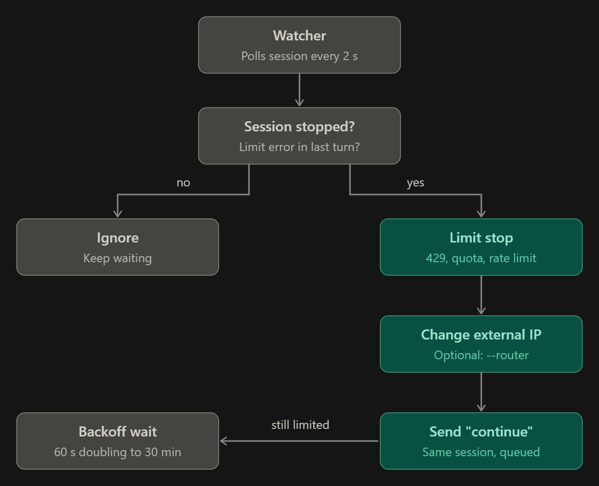

# agent-tools

A self-contained watcher that resumes an OpenCode session when it stops on a
usage limit.

## Requirements

- Python 3.9+
- A running OpenCode instance (tested with 2.0.11)
- Standard library only; nothing to install

Linux and macOS are supported. On Windows, omit `--detach`.

## Workflow
 

 
1. The watcher polls the OpenCode session every second (`--poll`).
2. When the session stops, it reads the last assistant turn. If the failed
   turn is not visible yet, it re-reads once after `--recheck` seconds.
3. If the error matches a limit pattern (`429`, `quota`, `rate limit`, ...), it counts as a limit stop. Anything else is ignored.
4. With `--router`, the router WANs restart first to get a new external IP. Without it, this step is skipped.
5. The watcher sends `continue` to the same session.
6. If that also hits the limit within 90 s (`--retry-window`), it waits 30 s, doubling each time up to 5 min (`--retry-wait`, `--max-retry-wait`). A limit that arrives later means the quota was working, so the next continue is immediate and the backoff resets.

## Files

| File | Purpose |
|---|---|
| `autocontinue.py` | watcher: detects limit stops, retries with backoff, sends the prompt |
| `router_restart.py` | stable entry point used by the watcher |
| `router_kit/` | router and IP-change package |
| `router_kit/base.py` | driver/strategy interfaces, registry, plugin loader |
| `router_kit/restart.py` | selects a driver and strategy, then runs it |
| `router_kit/drivers/` | router drivers; add new routers here |
| `router_kit/drivers/huawei_dg8045.py` | built-in Huawei DG8045 driver |
| `router_kit/drivers/huawei_client.py` | low-level Huawei gateway client (legacy TLS, RSA login, CSRF, API) |
| `router_kit/drivers/zte_h168n.py` | built-in ZTE ZXHN H168N V3.5 driver |
| `router_kit/drivers/zte_client.py` | low-level ZTE gateway client (SHA256 login, session token, WAN Apply) |
| `router_kit/strategies/` | IP-change strategies; add new methods here |
| `router_kit/strategies/pppoe_wan.py` | built-in PPPoE WAN-bounce strategy |
| `opencode_plugin/` | optional OpenCode plugin exposing `router.change_ip` |
| `loadenv.py` | standard-library `.env` loader |
| `.env.example` | configuration template |
| `README.md` | documentation |

No credentials are stored in the tracked source files. Router values belong
in `.env`, which is gitignored.

## Setup

1. Create the local configuration file. This is only needed for router
   control; the watcher itself runs without it.

   ```bash
   cp .env.example .env
   chmod 600 .env
   ```

2. Verify server and session detection:

   ```bash
   ./autocontinue.py --status
   ```

3. Start the watcher:

   ```bash
   ./autocontinue.py
   ```

   Add `--detach` to run it in the background. The default log is
   `/tmp/opencode/autocontinue.log`.

## Configuration

`loadenv.py` reads `.env` from the script folder at startup. Existing
environment variables take precedence. Keep `.env` out of commits, archives,
and manual copies of the folder.

| Variable | Default | Use |
|---|---|---|
| `OPENCODE_SERVER_URL` | `opencode service status`, else `http://127.0.0.1:4096` | OpenCode base URL |
| `OPENCODE_SERVICE_JSON` | `~/.config/opencode/service.json` | file containing the server password |
| `OPENCODE_SESSION_ID` | auto-detect | session to watch when `--session` is omitted |
| `ROUTER_DRIVER` | `auto` | router driver: `auto`, `huawei_dg8045`, `zte_h168n`, or `module:Class` |
| `ROUTER_HOST` / `ROUTER_PORT` | `192.168.1.1` / `443` | gateway address (use port `80` for `zte_h168n`) |
| `ROUTER_USER` / `ROUTER_PASS` | none (required for `--router`) | gateway login |
| `ROUTER_PPP_USER` / `ROUTER_PPP_PASS` | none | PPPoE credentials used by `zte_h168n` |
| `IP_CHANGE_STRATEGY` | `pppoe_wan` | IP-change strategy: `pppoe_wan` or `module:Class` |
| `ROUTER_PLUGINS` | none | comma-separated modules to import before selecting plugins |
| `ROUTER_WANS` | none (required for `--router`) | comma-separated WANs to restart together |
| `ROUTER_CONNECT_TIMEOUT` | 3 s | connection timeout when no gateway answers |

Router control is off by default. Built-in drivers support Huawei DG8045-style
gateways and the ZTE ZXHN H168N V3.5. On other networks, leave `--router`
disabled or add a driver (see below).

## Usage

```bash
python3 autocontinue.py --status        # server, session, last-turn verdict
python3 autocontinue.py                 # watch the running session
python3 autocontinue.py --all           # watch any session that starts running
python3 autocontinue.py --session ses_xxx --max 3
python3 autocontinue.py --dry-run --for 60
python3 autocontinue.py --detach        # background, logs to /tmp/opencode/autocontinue.log
```

Stop the watcher with `Ctrl-C`, `SIGTERM`, or:

```bash
pkill -f autocontinue.py
```

Alternatively, start it with `--stop-file /tmp/agent.stop` and stop it with
`touch /tmp/agent.stop`.

## Options

| Flag | Default | Meaning |
|---|---|---|
| `--prompt` | `continue` | text sent back into the session |
| `--delivery` | `queue` | `queue` waits for the turn to drain; `steer` injects mid-turn |
| `--max` | 0 (unlimited) | stop after N prompts |
| `--retry-window` | 90 s | a limit stop this soon after a continue is the same episode and uses backoff; a later one continues immediately |
| `--retry-wait` | 30 s | first delay after a continue that also hits the limit |
| `--max-retry-wait` | 300 s | cap for the doubling delay |
| `--recheck` | 1 s | re-read a stop with no visible limit error once before ignoring it |
| `--poll` | 1 s | how often session state is checked |
| `--scan-text` | off | treat a normal turn whose text mentions a limit as a limit stop |
| `--dry-run` | off | detect and log only |
| `--router` / `--no-router` | off | change the IP before each continue |
| `--router-driver` | `ROUTER_DRIVER` from `.env`, else `auto` | router driver name or plugin path |
| `--ip-strategy` | `IP_CHANGE_STRATEGY` from `.env`, else `pppoe_wan` | IP-change strategy name or plugin path |
| `--router-wans A,B` | `ROUTER_WANS` from `.env` | WANs to restart together |
| `--router-settle` | 1 s | seconds the new IP must stay up before it is trusted |
| `--router-ip-wait` | 30 s | maximum wait for a new external IP |
| `--router-timeout` | 30 s | maximum wait for a WAN to drop or reconnect |

## Behaviour

```
running --(stops)--> check last assistant turn
                       |
                       +-- limit error?  -> restart router WANs
                       |                     (ROUTER_WANS, together)
                       |                     confirm new IP (1 bounce max)
                       |                     -> send "continue" to the SAME session
                       +-- anything else -> ignore, keep waiting
```

The router step runs only with `--router`. If it fails (router offline, login
error), the failure is logged and the continue is still sent.

After a continue, the watcher returns to waiting. A limit stop that arrives
within `--retry-window` (default 90 s) is the same episode, so it is delayed by
`--retry-wait` and the delay doubles up to `--max-retry-wait`. A limit stop
that arrives later means the quota was working, so it continues immediately
and resets the backoff. A stop without a limit error also resets it, and a new
stop never postpones a continue that is already queued.

Before sending, the watcher checks the session once more. If the user (or
OpenCode itself) already resumed it during the router cycle, the queued
continue is dropped instead of posting an extra prompt.

The router is bounced **once per limit episode**. If the new IP still hits the
limit, the watcher keeps retrying the prompt with backoff but leaves the
router alone; changing the IP again cannot help and only drops the connection.
A productive run or a normal stop starts a new episode and re-allows one
bounce.

## Router restart

Disabled by default. With `--router`, the selected strategy runs before
resuming. The default `pppoe_wan` strategy cycles the links in `ROUTER_WANS`:

1. Drop every WAN at once instead of waiting for the first one to reconnect.
2. Reconnect each WAN the moment it reports down, so the links reconnect in
   parallel.
3. Poll every 0.4 s until every WAN is `Connected` and the external IP has
   changed; the new IP must stay up for `--router-settle` (default 1 s).
4. Send `continue`.

Drivers without the fast restart hooks keep the sequential `restart_wan()`
behaviour. The whole cycle is bounded by `--router-timeout` and
`--router-ip-wait`. On the setup this was tuned for, the cycle dropped from
about 16 s to about 8-10 s; the fixed 5 s settle and 2-3 s polling were the
main cost.

`router_kit/restart.py` selects the driver and strategy and runs the
sequence. The low-level clients are `router_kit/drivers/huawei_client.py` and
`router_kit/drivers/zte_client.py`. For the ZTE driver, step 1 is the router's
Internet -> WAN -> `INTERNET_TR069_R_PTM` form: the PPPoE username and password
from `ROUTER_PPP_USER` / `ROUTER_PPP_PASS` are filled in and submitted, which
makes the gateway redial. The gateway briefly drops internet during the cycle.

## Router drivers and IP-change strategies

The router connection and the IP-change method are separate plugins. This
allows switching routers, or replacing the whole IP-change approach, without
changing the watcher.

### Drivers

A driver implements `RouterDriver` from `router_kit`:

- `connect()` and `close()`
- `external_ip()`
- `wans()` — returns a list of `{"name", "alias", "status", "raw"}` items
- `restart_wan(name, log, timeout)`
- optional `reboot(log)`

Built-in: `huawei_dg8045` and `zte_h168n`. `ROUTER_DRIVER=auto` tries every
registered driver and uses the first one that connects. Select one explicitly
with `ROUTER_DRIVER=zte_h168n` (port `80`), or load an external driver with
`ROUTER_DRIVER=my_router:MyDriver`. The module must be importable and the
attribute may be a class or a zero-argument factory.

Add a built-in driver by creating `router_kit/drivers/my_router.py` and
importing it in `router_kit/drivers/__init__.py`.

```python
from router_kit import RouterDriver, register_driver

class MyDriver(RouterDriver):
    name = "my_router"

    def connect(self):
        ...

    def close(self):
        ...

    def external_ip(self):
        ...

    def wans(self):
        ...

    def restart_wan(self, name, log, timeout=60.0):
        ...

register_driver("my_router", MyDriver)
```

### IP-change strategies

A strategy implements `IpChangeStrategy.change(driver, log, **options)` and
returns `{"before": ..., "after": ..., "changed": ...}`. Built-in:
`pppoe_wan`. Select another with `IP_CHANGE_STRATEGY=my_ip:MyStrategy`.
Strategies receive `wans`, `settle`, `ip_wait`, `timeout`, and `dry_run`.

Add a built-in strategy by creating `router_kit/strategies/my_ip.py` and
importing it in `router_kit/strategies/__init__.py`.

```python
import time

from router_kit import IpChangeStrategy, register_strategy

class RebootStrategy(IpChangeStrategy):
    name = "reboot"

    def change(self, driver, log, *, wans=None, settle=5.0, ip_wait=45.0,
               timeout=60.0, dry_run=False):
        before = driver.external_ip()
        if dry_run:
            return {"before": before, "after": before, "changed": False}

        driver.reboot(log)
        after = before
        deadline = time.time() + ip_wait
        while time.time() < deadline:
            after = driver.external_ip()
            if after and after != before:
                break
            time.sleep(3)

        return {"before": before, "after": after,
                "changed": bool(after and before and after != before)}

register_strategy("reboot", RebootStrategy)
```

The driver must override `reboot()` for this strategy.

Select plugins in `.env`:

```ini
ROUTER_DRIVER=my_router:MyDriver
IP_CHANGE_STRATEGY=my_ip:MyStrategy
```

To make external plugins available to `auto` or to a registered name, import
them first:

```ini
ROUTER_PLUGINS=my_router,my_ip
ROUTER_DRIVER=auto
IP_CHANGE_STRATEGY=reboot
```

## OpenCode plugin

`opencode_plugin/` is a small local plugin that exposes the router restart as
an OpenCode tool. Load it from global `~/.config/opencode/opencode.json`:

```jsonc
{
  "plugins": [
    {
      "package": "D:\\path\\to\\OpenCode-restart-limit-tool\\opencode_plugin",
      "options": {
        "repo": "D:\\path\\to\\OpenCode-restart-limit-tool",
        "wans": "INTERNET_TR069_R_PTM"
      }
    }
  ]
}
```

It registers the `router.change_ip` tool. In Code Mode:

```js
await tools.router.change_ip({})            // bounce the WAN and change IP
await tools.router.change_ip({ dry_run: true })  // inspect without changing
```

The tool uses the same `.env` driver, strategy, and WAN configuration as
`autocontinue.py`.

## OpenCode API

- server URL: `$OPENCODE_SERVER_URL`, else `opencode service status`
- auth: basic `opencode:<password>` from `~/.config/opencode/service.json`
- `GET /api/session/active` — active sessions
- `GET /api/session/{id}/message?limit=5&order=desc&type=assistant` — last turn
- `POST /api/session/{id}/prompt` — `{"text": "...", "delivery": "queue"}`

## Limit detection

A turn counts as a limit stop when it has `error`, `retry`, or
`finish == "error"` and the error matches:

```
insufficient[-_\s]?quota | quota[-_\s]?exceeded | budget exceeded | usage limit
limit (has been|was)? reached | rate[-_\s]?limit | too many requests
out of credits | credits (exhausted|exceeded)
exceeded your (plan|usage)?limit | reached your (usage)?limit
payment required | \b402\b | \b429\b
```

This matches the provider-error classification used by OpenCode, plus common
phrasings.

## Caveats

- If the limit is still active, the continue fails again. The backoff grows
  until the limit window resets.
- Each retry adds a user message (`continue`) to the session history.
- The session must still exist. Deleting it stops the watcher naturally.
- Without `--all`, only the selected session is watched. With `--all`, any
  session that becomes active is followed.
